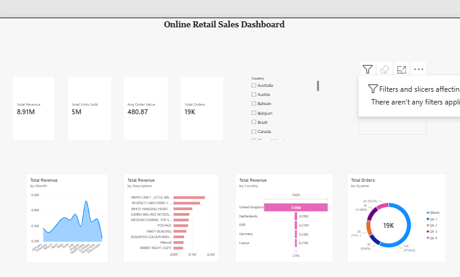

 # Online Retail Sales Dashboard

## Project Overview
An interactive Power BI dashboard analyzing international e-commerce sales performance. The report tracks key revenue metrics, order volume, average order value, and product performance across global markets.

## Dashboard Preview

## Key Metrics & Features
* *Executive KPIs:* Tracks *8.91M* in Total Revenue, *5M* Total Units Sold, *480.87* Average Order Value, and *19K* Total Orders.
* *Interactive Slicers:* Filter dynamically by *Country* and *Invoice Date* to examine regional trends and seasonal performance.
* *Visual Breakdowns:* Includes category revenue rankings, quarterly order distribution, and monthly sales trends.

## Tools Used
* *Microsoft Power BI Desktop* (Power Query, Data Modeling, DAX, and Data Visualization)
*
